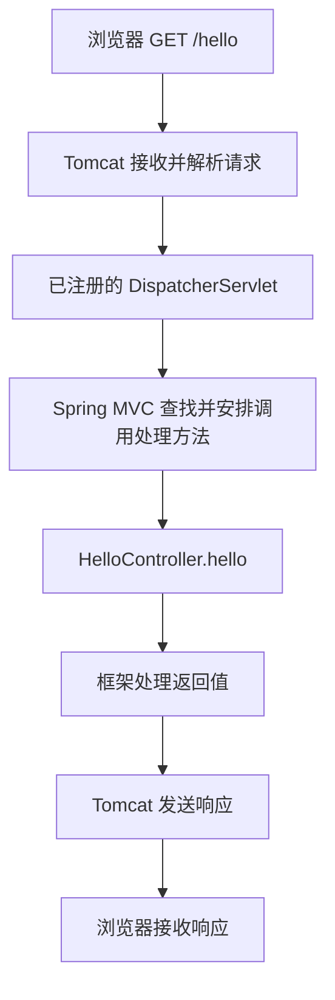
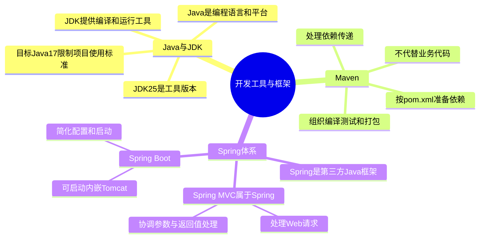
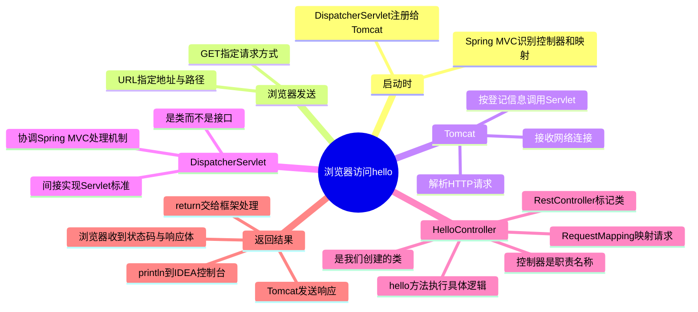
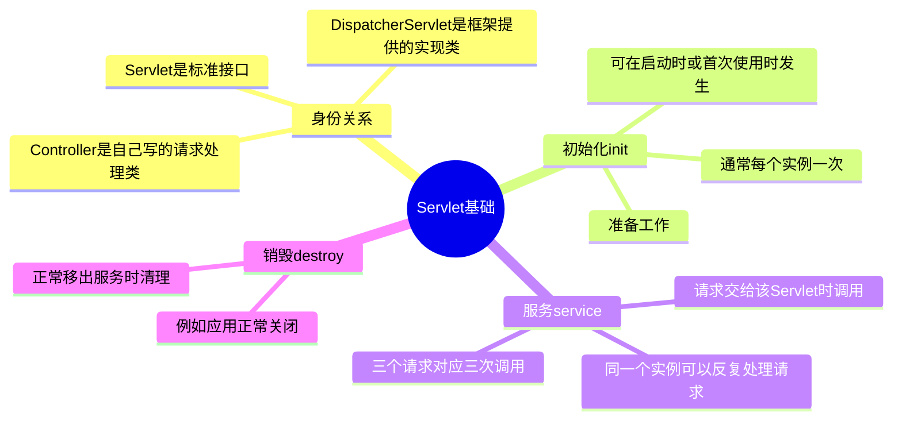

# JavaWeb 学习记录

从“浏览器怎样调用我写的 Java 方法”出发，整理 AI 全栈成长营 Level 2「JavaWeb 核心技术」的学习过程。这里既保存进度，也把学习中真正困惑过的问题讲清楚，供以后回看。

不要求一开始记住所有框架名字。先抓住主线：**Maven 准备项目依赖，Spring Boot 帮助启动应用，Tomcat 接收请求，Spring MVC 安排调用我们写的方法。**

## 当前进度

- 当前章节：Web 应用概览，已进入 Servlet 基础概念。
- 已验证：浏览器访问 `/hello`，开发者工具显示请求方式 GET、状态码 200 OK。
- 已学习但需要继续练习：工具与框架分工、请求响应、Servlet 调用关系和生命周期。
- 下一步：请求参数 `/greet?name=小林`；示例已讲解，尚未确认完成。
- Cookie、Session、登录保持及并发数据问题仅简单了解，不计入已完成内容。

## 学习路线

| 目录板块 | 内容 | 状态 |
|---|---|---|
| Web 应用概览 | HTTP、Tomcat、创建与访问应用 | 学习中 |
| Servlet 核心技术 | 概述、生命周期、配置、请求响应、乱码、ServletContext | 已入门，未完成 |
| 会话状态管理 | Cookie、Session、登录状态保持 | 待正式学习 |
| 文件上传与下载 | 上传与下载实操 | 待学习 |
| 前后端分离技术 | MVC、JSON、Axios、跨域 | 待学习 |

目前借助 Spring Boot 搭建可运行的 Web 示例；这不代表已经完成原目录 Level 3 的 Spring Boot 系统学习。

## 知识点索引

- [工具和框架的关系](#工具和框架的关系)
- [请求如何到达自己的方法](#请求如何到达自己的方法)
- [控制器和注解](#控制器和注解)
- [HTTP 请求与响应](#http-请求与响应)
- [Servlet 生命周期](#servlet-生命周期)
- [今天的思维导图](#今天的思维导图)
- [拓展了解：为什么登录一次后不用重复输入密码](#拓展了解为什么登录一次后不用重复输入密码)
- [每日学习记录](#每日学习记录)

## 工具和框架的关系

| 名称 | 作用 |
|---|---|
| Java | 编写类、接口和业务方法的语言 |
| JDK | 提供 Java 编译和运行工具 |
| Maven | 根据 pom.xml 管理依赖，组织编译、测试和打包 |
| Spring Framework | 第三方 Java 框架，不是 JDK 自带功能 |
| Spring MVC | Spring 中负责 Web 请求处理的框架 |
| Spring Boot | 简化 Spring 应用配置和启动 |
| Tomcat | 接收网络连接、解析 HTTP 请求、调用 Servlet、发送响应 |

Maven 可以用于没有 Spring Boot 的项目；Spring Boot 也可以使用其他构建工具。

### Maven 和 Spring Boot 都像“帮我准备项目”，区别在哪里？

可以把开发应用想成开餐厅：Maven 按清单采购设备、组织备料和打包；Spring Boot 则帮助把厨房配置好并启动营业。采购工具本身不接单做菜，厨房方案也不代替我们的业务代码。

例如，以前在 JdbcStudy 中声明 MySQL 驱动，Maven 就负责准备它；当时没有 Spring Boot，Maven 仍然能工作。现在声明 Spring Boot 的 Web 依赖，Maven 负责下载相关库，启动应用时才由 Spring Boot 的配置机制把相关组件组织起来。

```text
pom.xml 写需要什么 → Maven 准备依赖
运行启动类        → Spring Boot 配置并启动应用
浏览器访问接口    → Web 组件和我们写的代码处理请求
```

### Spring MVC 属于 Java 吗？

它是**用 Java 编写的第三方框架代码**，属于 Spring Framework 的一部分，不属于 Java 语言或 JDK 自带的类库。引入依赖后，这些框架代码与我们自己的 Java 代码一起运行。

### 还需要单独下载 Tomcat 吗？

当前采用内嵌 Tomcat 的 Spring Boot Web 项目，不需要另行安装独立 Tomcat。相关库通过项目依赖引入，应用启动时一起启动，应用停止时一起停止。不能把它理解成 IDEA 或 JDK 内置了 Tomcat。

本次使用 JDK 25，项目 java.version 设置为 17：前者是实际工具，后者在 Spring Boot 默认构建配置下指定目标 Java 标准。修改 java.version 不会自动安装或切换 JDK。

这就像使用新版文档编辑器，按旧版兼容要求保存：工具可以更新，但项目不能因此随意使用超出目标版本的语法和标准 API；依赖也需要满足相应运行环境要求。

## 请求如何到达自己的方法



- Servlet 是接口；DispatcherServlet 是 Spring MVC 提供的类，间接实现 Servlet 接口。
- 启动过程中 DispatcherServlet 注册给 Tomcat，并建立 Servlet 路径映射。
- Spring MVC 识别控制器方法上的映射；请求到来后，按预先建立的关系处理。
- 所谓“唤醒”实际是处理线程调用对象的方法，不是类自动执行。

### Tomcat 已经能处理 HTTP，为什么还需要 DispatcherServlet？

Tomcat 知道如何接收网络连接、解析 HTTP、按 Servlet 标准调用对象，但不会单凭我们写了一个 hello() 就自动认识它。`@RequestMapping` 等映射规则由 Spring MVC 识别。

DispatcherServlet 是 Spring MVC 的统一入口，协调路径匹配、方法调用和返回结果处理等组件。可以把 Tomcat 想成接待入口，DispatcherServlet 是分诊台，Controller 方法则负责具体业务。

### 都是 Java 代码，为什么 DispatcherServlet 先被调用？

因为**启动时提前登记了不同层次的映射**，不是它天然比我们的类“更靠近 Java 内部”。

```text
Tomcat 的登记：匹配 Servlet 映射的请求 → DispatcherServlet
Spring MVC 的登记：/hello → HelloController 的 hello() 方法
```

请求来到后，Tomcat 按登记关系调用 DispatcherServlet 的 service()，传入请求和响应对象；再由 Spring MVC 的处理机制找到并安排调用我们的 hello()。

### Servlet 是接口，为什么它还能做这些事情？

接口只规定契约，不会自动获得“查找方法”的能力。`Servlet` 和 JavaSE 中学过的接口使用同一种机制；`DispatcherServlet` 是通过继承间接实现它的具体类。查找、调用、转换等功能由框架的实现代码和协作组件完成。

## 控制器和注解

```java
@RestController
public class HelloController {
    @RequestMapping("/hello")
    public String hello() {
        System.out.println("Hello world!");
        return "Hello world!";
    }
}
```

- HelloController 是自己创建的 Java 类，承担请求处理职责，因此称为控制器。
- 类名包含 Controller 只是命名习惯，不会使它自动生效。
- @RestController 标记控制器，方法返回值用作响应内容；类需被 Spring 扫描识别。
- @RequestMapping 建立请求映射；此例未限定 HTTP 方法。
- @GetMapping 只匹配 GET；@PostMapping 只匹配 POST。
- println 输出到服务端控制台；return 的结果经过框架处理后成为响应内容。

### HelloController 到底是普通类，还是 Controller 类？

**两者说的是同一个类。** HelloController 是我们创建的 Java 类；“控制器”是按职责对它的称呼，就像称 Student 为“学生类”。没有因此多出另一个叫 Controller 的对象，也不要求它继承一个叫 Controller 的类。

`@RestController` 是注解标记，不是一次方法调用。Spring 识别这个类后，将它作为控制器管理。类名换成其他合法名字，配套引用调整好后也可以承担同样职责。

### 注解为什么一个写在类外，一个写在类里？

因为修饰的对象不同。注解写在要修饰的声明上方：`@RestController` 标记类，方法上的 `@RequestMapping` 标记方法。

`@RequestMapping` 也可以写在类上，设置共享路径前缀；不是规定它只能写在类里面。

### 普通方法不行吗，为什么要控制器？

普通方法当然能用，hello() 本来就是普通 Java 方法。但浏览器发送的是 HTTP 请求，不会直接执行 Java 的 `对象.hello()`。

框架通过控制器和映射把网络请求接到 Java 方法上。辅助方法仍然可以按普通方式调用；并非每个方法都需要变成网络接口。

## HTTP 请求与响应

- URL 是资源地址，例如 http://localhost:8080/hello。
- localhost 表示本机，8080 是端口，/hello 是路径。
- GET 通常用于获取数据，条件常放在 URL 中。
- POST 通常用于提交处理数据，数据常放在请求体；URL 也能带查询参数。
- POST 不会自动加密；传输加密依赖 HTTPS。
- 状态码表示处理情况，响应体装实际内容。返回文字“失败”不会自动改变状态码。

### URL 和参数是什么关系？

```text
http://localhost:8080/students?studentId=2026001
│      │         │    │        └─ 查询参数：指定学号
│      │         │    └─ 请求路径
│      │         └─ 端口
│      └─ 主机：自己的电脑
└─ 通信协议
```

### GET 就是地址栏，POST 就是请求体吗？

这是常见用法，但不能画等号。GET、POST 是请求方式；URL 查询参数、请求体是携带数据的位置。浏览器地址栏输入地址并回车通常发送 GET，POST 也可以在 URL 中携带参数。POST 不因为数据没有显示在地址栏就变得加密。

| 状态码 | 含义 |
|---|---|
| 200 | 请求成功 |
| 201 | 创建成功 |
| 400 | 请求不符合要求 |
| 401 | 缺少有效认证 |
| 403 | 拒绝访问 |
| 404 | 找不到目标资源 |
| 405 | 不支持该请求方式 |
| 500 | 服务器内部错误 |

## Servlet 生命周期

| 方法 | 职责 | 频率 |
|---|---|---|
| init | 初始化准备 | 通常每个实例一次 |
| service | 处理交给该 Servlet 的请求 | 每次请求调用 |
| destroy | 移出服务时清理 | 正常销毁实例时调用 |

初始化可以发生在启动时或首次使用时。通常复用 Servlet 实例；三次请求交给同一个实例，service 对应执行三次，不代表初始化三次。

就像员工入职准备一次，之后接待多次，最后办理离职交接。生命周期描述的是 Servlet 实例的工作过程，不是每个用户各自的登录过程。

## 今天的思维导图

### 工具与框架：谁帮我做什么？



### 一次请求：谁先收到，谁具体执行？



### Servlet：接口和对象生命周期



## 拓展了解：为什么登录一次后不用重复输入密码

**本节只是回答学习过程中顺带提出的问题，不计入今天正式完成内容，不要求当前掌握。** 会话管理和并发问题以后再系统练习。

常见 Cookie + Session 方案中，登录成功后，服务器通过 Session 保存登录信息，浏览器通过 Cookie 保存对应的 Session ID；后续请求自动携带符合条件的 Cookie，服务器据此找到并验证会话。

这不是因为复用了同一个 Servlet。Servlet 像很多人共用的服务窗口，凭证才用于关联身份。凭证过期、退出登录、清除 Cookie 后可能需要重新登录；长期“记住我”也可能使用额外凭证。浏览器自动填写密码是另一种功能。

Cookie 还可以保存语言偏好、关联购物车，并非只用于登录。不应把明文密码当成普通 Cookie 数据保存。

同一 Servlet 实例可能并发处理多人的请求，因此不能随意用实例字段保存“当前用户名”；请求临时数据优先放局部变量。这一点仅作提醒，暂不展开线程安全知识。

## 每日学习记录

### 2026-10-29：Web 入门与请求处理链路

**实践与证据**

- 创建 Spring Boot Web 项目，编写 HelloController。
- 浏览器访问 /hello，在 Network 面板确认 GET 和 200 OK。
- 理解控制台打印与返回浏览器内容的区别。

**今天的理解**

- Maven 准备依赖和构建项目，Spring Boot 简化配置和启动；两者不是同一种工具。
- Tomcat 与 Spring MVC 分工协作；DispatcherServlet 是注册给容器的入口。
- Controller 是自己创建的类所承担的职责，注解标记用途与请求映射。
- Servlet 接口使用的仍是 JavaSE 中学过的接口机制。

**易混淆点**

- 不把 DispatcherServlet 当成接口：接口叫 Servlet。
- 不把 Spring MVC 当成 JDK 内置功能：它是第三方 Java 框架。
- 不把“都在 Java 程序里”当成自动调用原因：需要注册、映射和实际方法调用。
- 不把内嵌 Tomcat 理解为 IDEA 或 JDK 内置：它随项目依赖引入。

**仅作了解**

Cookie、Session、登录保持和多用户并发数据问题，本日不作为正式完成内容。

**下次接续**

在现有项目中实践 /greet?name=小林，学习 @RequestParam 如何接收参数；尚未确认该示例完成。

## 记录约定

每次更新同步维护当前进度、知识索引、当天总结和实际示例；区分“讲解过”“写过”“运行验证过”，不将预告内容算作完成。
