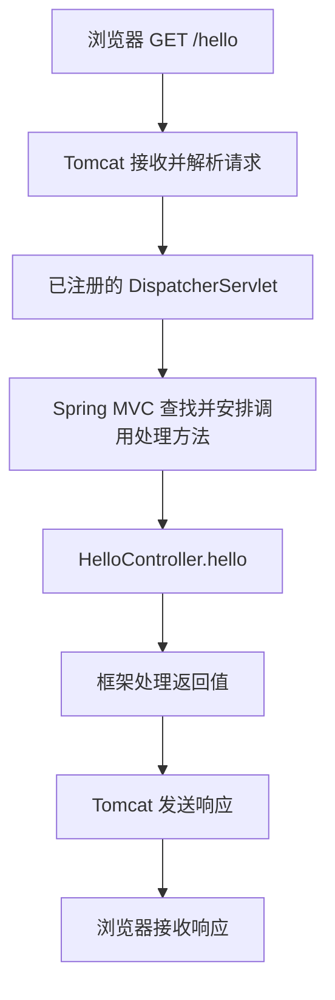
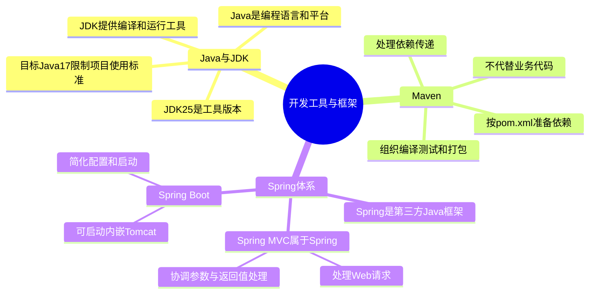
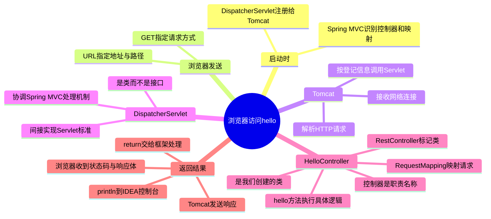
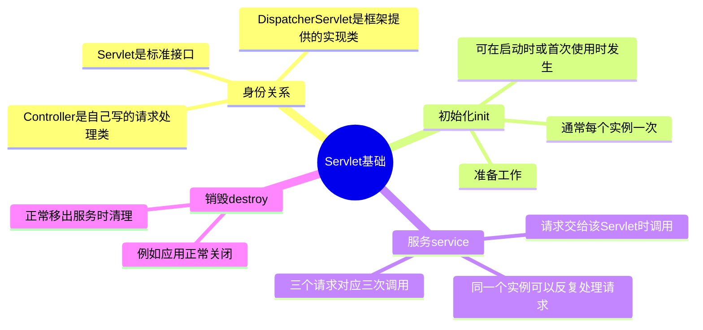
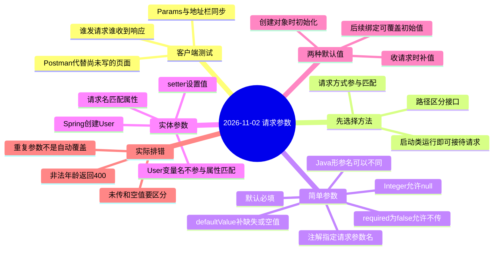

# JavaWeb 学习记录

从“浏览器怎样调用我写的 Java 方法”出发，整理 AI 全栈成长营 Level 2「JavaWeb 核心技术」的学习过程。这里既保存进度，也把学习中真正困惑过的问题讲清楚，供以后回看。

不要求一开始记住所有框架名字。先抓住主线：**Maven 准备项目依赖，Spring Boot 帮助启动应用，Tomcat 接收请求，Spring MVC 安排调用我们写的方法。**

> 仓库记录起始：2026-10-28（Maven 历史记录）；JavaWeb 正式记录起始：2026-10-29。
> 最近更新：2026-11-02。后续按实际学习日期持续追加；日期表示学习时间，补录或复制日期另行标明。

## 日期导航与代码目录

| 学习日期 | 主题 | 笔记与代码 |
|---|---|---|
| 2026-10-28 | Maven 环境、依赖、POM 和下载故障排查 | [原记录副本](notes/2026-10-28/maven.md) · [原项目配置](MavenStudy/pom.xml) |
| 2026-10-29 | JavaWeb 入门、请求响应和 Servlet 基础 | [当天记录](#2026-10-29web-入门与请求处理链路) · [Spring Boot 工程](SpringBoot_javaWeb_quickstart) |
| 2026-11-02 | Postman、简单参数、实体参数、默认值与可选参数 | [当天问答总结](#day-2026-11-02) · [HelloController](SpringBoot_javaWeb_quickstart/src/main/java/com/zhangyihang/springboot_javaweb_quickstart/Controller/HelloController.java) · [User](SpringBoot_javaWeb_quickstart/src/main/java/com/zhangyihang/springboot_javaweb_quickstart/pojo/User.java) |

10 月 28 日的 Maven 内容原先归档在 Database-Basics，已于 10 月 29 日复制到本仓库，保留原始来源和日期。今后 JavaWeb 及其 Maven 前置学习统一在这里接续记录；数据库仓库中的历史内容保留。

### 如何查看和运行代码

- [SpringBoot_javaWeb_quickstart](SpringBoot_javaWeb_quickstart)：当前本机工程快照，最近同步日期 2026-11-02，包含 POM、启动类、Controller、资源配置、生成的测试类和 Maven Wrapper 文件。
- IDEA 打开该子目录的 pom.xml 加载工程；运行 SpringBootJavaWebQuickstartApplication 启动类，再访问 http://localhost:8080/hello。
- 当前 POM 为 Spring Boot 4.1.2、目标 Java 17，使用 spring-boot-starter-webmvc；本机学习时选用 JDK 25。可继续使用 IDEA 配置的 Maven。Wrapper 自身配置了发行版，不等于此前 IDEA 的内置 Maven 版本。
- [HelloController.java](SpringBoot_javaWeb_quickstart/src/main/java/com/zhangyihang/springboot_javaweb_quickstart/Controller/HelloController.java) 当前返回 `Hello world!喵`。下文 `Hello world!` 是讲解时的示例，二者不矛盾。
- 源码保留原貌。其中旧注释“告诉浏览器这是请求处理类”不准确，应理解为“告诉 Spring 这个类用于处理请求”；以下概念说明以此为准。
- 生成的 contextLoads 测试随工程保存，本次未运行该测试。/greet、/introduce、/user-info 已保存到源码，学习者反馈相应 Postman/浏览器测试成功。/introduce 当前生效的是可选年龄版本，必填与默认 18 的旧版本保留为注释。
- [MavenStudy](MavenStudy)：2026-10-28 从数据库仓库复制的历史快照，只有 pom.xml，包含 Logback 依赖；不要把它当作当前本机 MavenStudy 的完整镜像。
- 两个子目录是独立工程，不是已配置好的 Maven 父子模块。根目录 README 是学习入口。
- 本次未上传 IDEA 私有配置、target、依赖缓存或密码；只归档学习源码与必要构建文件。

## 当前进度

- 当前章节：网课 Day05-03「请求：简单参数与实体参数」；Postman 入门测试已完成。
- 已实践：/hello、/greet、/introduce、/user-info；参数名绑定、String → int 转换、缺少参数、默认值、可选 Integer、对象属性绑定。
- 运行反馈：学习者已验证正常请求、age=abc 的 400、默认年龄、未填年龄，以及实体参数未传 age 为 null。
- 源码状态：HelloController 当前 /introduce 使用 required=false；User 只有 name、Integer age 和 getter/setter，尚未显式增加构造初始值。
- 待继续：确认本节是否还有嵌套对象例子，再进入 Day05-04 数组、集合参数。日期、JSON、路径参数及响应处理尚未系统实操。
- Cookie、Session、登录保持仅简单了解；并发只理解到请求局部变量独立、实例字段可能共享，未完成系统实践。
- AIFoundry 本日仅查看公开课程路线、检查 Node 环境，没有开始其项目实践；随后回到当前 JavaWeb 网课。10 月 30 日 UDP 代码保存在 [Java-Basics](https://github.com/theotherDancer/Java-Basics/tree/main/NetworkProgramming)，不混作本日内容。

## 学习路线

| 目录板块 | 内容 | 状态 |
|---|---|---|
| Web 应用概览 | HTTP、Tomcat、创建与访问应用 | 已完成首轮入门，持续巩固 |
| Servlet 核心技术 | 概述、生命周期、配置、请求响应、乱码、ServletContext | 已理解调用关系和生命周期；当前借助 Spring MVC 实践请求参数，其余未完成 |
| 会话状态管理 | Cookie、Session、登录状态保持 | 待正式学习 |
| 文件上传与下载 | 上传与下载实操 | 待学习 |
| 前后端分离技术 | MVC、JSON、Axios、跨域 | 待学习 |

目前借助 Spring Boot 搭建可运行的 Web 示例；这不代表已经完成原目录 Level 3 的 Spring Boot 系统学习。

## 知识点索引

- [日期导航与代码目录](#日期导航与代码目录)
- [2026-10-28 Maven 原始记录副本](notes/2026-10-28/maven.md)
- [工具和框架的关系](#工具和框架的关系)
- [请求如何到达自己的方法](#请求如何到达自己的方法)
- [控制器和注解](#控制器和注解)
- [HTTP 请求与响应](#http-请求与响应)
- [Servlet 生命周期](#servlet-生命周期)
- [2026-10-29 思维导图](#今天的思维导图)
- [Postman、简单参数与实体参数问答](#day-2026-11-02)
- [2026-11-02 参数接收思维导图](#params-map-2026-11-02)
- [拓展了解：为什么登录一次后不用重复输入密码](#拓展了解为什么登录一次后不用重复输入密码)
- [每日学习记录](#每日学习记录)

## 工具和框架的关系

| 名称 | 作用 |
|---|---|
| Java | 编写类、接口和业务方法的语言 |
| JDK | 提供 Java 编译和运行工具 |
| Maven | 根据 pom.xml 管理依赖，组织编译、测试和打包 |
| Spring Framework | 第三方 Java 框架，不是 JDK 自带功能 |
| Spring MVC | Spring 中负责 Web 请求处理的框架 |
| Spring Boot | 简化 Spring 应用配置和启动 |
| Tomcat | 接收网络连接、解析 HTTP 请求、调用 Servlet、发送响应 |

Maven 可以用于没有 Spring Boot 的项目；Spring Boot 也可以使用其他构建工具。

### Maven 和 Spring Boot 都像“帮我准备项目”，区别在哪里？

可以把开发应用想成开餐厅：Maven 按清单采购设备、组织备料和打包；Spring Boot 则帮助把厨房配置好并启动营业。采购工具本身不接单做菜，厨房方案也不代替我们的业务代码。

例如，以前在 JdbcStudy 中声明 MySQL 驱动，Maven 就负责准备它；当时没有 Spring Boot，Maven 仍然能工作。现在声明 Spring Boot 的 Web 依赖，Maven 负责下载相关库，启动应用时才由 Spring Boot 的配置机制把相关组件组织起来。

```text
pom.xml 写需要什么 → Maven 准备依赖
运行启动类        → Spring Boot 配置并启动应用
浏览器访问接口    → Web 组件和我们写的代码处理请求
```

### Spring MVC 属于 Java 吗？

它是**用 Java 编写的第三方框架代码**，属于 Spring Framework 的一部分，不属于 Java 语言或 JDK 自带的类库。引入依赖后，这些框架代码与我们自己的 Java 代码一起运行。

### 还需要单独下载 Tomcat 吗？

当前采用内嵌 Tomcat 的 Spring Boot Web 项目，不需要另行安装独立 Tomcat。相关库通过项目依赖引入，应用启动时一起启动，应用停止时一起停止。不能把它理解成 IDEA 或 JDK 内置了 Tomcat。

本次使用 JDK 25，项目 java.version 设置为 17：前者是实际工具，后者在 Spring Boot 默认构建配置下指定目标 Java 标准。修改 java.version 不会自动安装或切换 JDK。

这就像使用新版文档编辑器，按旧版兼容要求保存：工具可以更新，但项目不能因此随意使用超出目标版本的语法和标准 API；依赖也需要满足相应运行环境要求。

## 请求如何到达自己的方法



- Servlet 是接口；DispatcherServlet 是 Spring MVC 提供的类，间接实现 Servlet 接口。
- 启动过程中 DispatcherServlet 注册给 Tomcat，并建立 Servlet 路径映射。
- Spring MVC 识别控制器方法上的映射；请求到来后，按预先建立的关系处理。
- 所谓“唤醒”实际是处理线程调用对象的方法，不是类自动执行。

### Tomcat 已经能处理 HTTP，为什么还需要 DispatcherServlet？

Tomcat 知道如何接收网络连接、解析 HTTP、按 Servlet 标准调用对象，但不会单凭我们写了一个 hello() 就自动认识它。`@RequestMapping` 等映射规则由 Spring MVC 识别。

DispatcherServlet 是 Spring MVC 的统一入口，协调路径匹配、方法调用和返回结果处理等组件。可以把 Tomcat 想成接待入口，DispatcherServlet 是分诊台，Controller 方法则负责具体业务。

### 都是 Java 代码，为什么 DispatcherServlet 先被调用？

因为**启动时提前登记了不同层次的映射**，不是它天然比我们的类“更靠近 Java 内部”。

```text
Tomcat 的登记：匹配 Servlet 映射的请求 → DispatcherServlet
Spring MVC 的登记：/hello → HelloController 的 hello() 方法
```

请求来到后，Tomcat 按登记关系调用 DispatcherServlet 的 service()，传入请求和响应对象；再由 Spring MVC 的处理机制找到并安排调用我们的 hello()。

### Servlet 是接口，为什么它还能做这些事情？

接口只规定契约，不会自动获得“查找方法”的能力。`Servlet` 和 JavaSE 中学过的接口使用同一种机制；`DispatcherServlet` 是通过继承间接实现它的具体类。查找、调用、转换等功能由框架的实现代码和协作组件完成。

## 控制器和注解

```java
@RestController
public class HelloController {
    @RequestMapping("/hello")
    public String hello() {
        System.out.println("Hello world!");
        return "Hello world!";
    }
}
```

- HelloController 是自己创建的 Java 类，承担请求处理职责，因此称为控制器。
- 类名包含 Controller 只是命名习惯，不会使它自动生效。
- @RestController 标记控制器，方法返回值用作响应内容；类需被 Spring 扫描识别。
- @RequestMapping 建立请求映射；此例未限定 HTTP 方法。
- @GetMapping 只匹配 GET；@PostMapping 只匹配 POST。
- println 输出到服务端控制台；return 的结果经过框架处理后成为响应内容。

### HelloController 到底是普通类，还是 Controller 类？

**两者说的是同一个类。** HelloController 是我们创建的 Java 类；“控制器”是按职责对它的称呼，就像称 Student 为“学生类”。没有因此多出另一个叫 Controller 的对象，也不要求它继承一个叫 Controller 的类。

`@RestController` 是注解标记，不是一次方法调用。Spring 识别这个类后，将它作为控制器管理。类名换成其他合法名字，配套引用调整好后也可以承担同样职责。

### 注解为什么一个写在类外，一个写在类里？

因为修饰的对象不同。注解写在要修饰的声明上方：`@RestController` 标记类，方法上的 `@RequestMapping` 标记方法。

`@RequestMapping` 也可以写在类上，设置共享路径前缀；不是规定它只能写在类里面。

### 普通方法不行吗，为什么要控制器？

普通方法当然能用，hello() 本来就是普通 Java 方法。但浏览器发送的是 HTTP 请求，不会直接执行 Java 的 `对象.hello()`。

框架通过控制器和映射把网络请求接到 Java 方法上。辅助方法仍然可以按普通方式调用；并非每个方法都需要变成网络接口。

## HTTP 请求与响应

- URL 是资源地址，例如 http://localhost:8080/hello。
- localhost 表示本机，8080 是端口，/hello 是路径。
- GET 通常用于获取数据，条件常放在 URL 中。
- POST 通常用于提交处理数据，数据常放在请求体；URL 也能带查询参数。
- POST 不会自动加密；传输加密依赖 HTTPS。
- 状态码表示处理情况，响应体装实际内容。返回文字“失败”不会自动改变状态码。

### URL 和参数是什么关系？

```text
http://localhost:8080/students?studentId=2026001
│      │         │    │        └─ 查询参数：指定学号
│      │         │    └─ 请求路径
│      │         └─ 端口
│      └─ 主机：自己的电脑
└─ 通信协议
```

### GET 就是地址栏，POST 就是请求体吗？

这是常见用法，但不能画等号。GET、POST 是请求方式；URL 查询参数、请求体是携带数据的位置。浏览器地址栏输入地址并回车通常发送 GET，POST 也可以在 URL 中携带参数。POST 不因为数据没有显示在地址栏就变得加密。

| 状态码 | 含义 |
|---|---|
| 200 | 请求成功 |
| 201 | 创建成功 |
| 400 | 请求不符合要求 |
| 401 | 缺少有效认证 |
| 403 | 拒绝访问 |
| 404 | 找不到目标资源 |
| 405 | 不支持该请求方式 |
| 500 | 服务器内部错误 |

## Servlet 生命周期

| 方法 | 职责 | 频率 |
|---|---|---|
| init | 初始化准备 | 通常每个实例一次 |
| service | 处理交给该 Servlet 的请求 | 每次请求调用 |
| destroy | 移出服务时清理 | 正常销毁实例时调用 |

初始化可以发生在启动时或首次使用时。通常复用 Servlet 实例；三次请求交给同一个实例，service 对应执行三次，不代表初始化三次。

就像员工入职准备一次，之后接待多次，最后办理离职交接。生命周期描述的是 Servlet 实例的工作过程，不是每个用户各自的登录过程。

## 今天的思维导图

### 工具与框架：谁帮我做什么？



### 一次请求：谁先收到，谁具体执行？



### Servlet：接口和对象生命周期



## 拓展了解：为什么登录一次后不用重复输入密码

**本节只是回答学习过程中顺带提出的问题，不计入今天正式完成内容，不要求当前掌握。** 会话管理和并发问题以后再系统练习。

常见 Cookie + Session 方案中，登录成功后，服务器通过 Session 保存登录信息，浏览器通过 Cookie 保存对应的 Session ID；后续请求自动携带符合条件的 Cookie，服务器据此找到并验证会话。

这不是因为复用了同一个 Servlet。Servlet 像很多人共用的服务窗口，凭证才用于关联身份。凭证过期、退出登录、清除 Cookie 后可能需要重新登录；长期“记住我”也可能使用额外凭证。浏览器自动填写密码是另一种功能。

Cookie 还可以保存语言偏好、关联购物车，并非只用于登录。不应把明文密码当成普通 Cookie 数据保存。

同一 Servlet 实例可能并发处理多人的请求，因此不能随意用实例字段保存“当前用户名”；请求临时数据优先放局部变量。这一点仅作提醒，暂不展开线程安全知识。

## 每日学习记录

### 2026-10-29：Web 入门与请求处理链路

**实践与证据**

- 创建 Spring Boot Web 项目，编写 HelloController。
- 浏览器访问 /hello，在 Network 面板确认 GET 和 200 OK。
- 理解控制台打印与返回浏览器内容的区别。

**今天的理解**

- Maven 准备依赖和构建项目，Spring Boot 简化配置和启动；两者不是同一种工具。
- Tomcat 与 Spring MVC 分工协作；DispatcherServlet 是注册给容器的入口。
- Controller 是自己创建的类所承担的职责，注解标记用途与请求映射。
- Servlet 接口使用的仍是 JavaSE 中学过的接口机制。

**易混淆点**

- 不把 DispatcherServlet 当成接口：接口叫 Servlet。
- 不把 Spring MVC 当成 JDK 内置功能：它是第三方 Java 框架。
- 不把“都在 Java 程序里”当成自动调用原因：需要注册、映射和实际方法调用。
- 不把内嵌 Tomcat 理解为 IDEA 或 JDK 内置：它随项目依赖引入。

**仅作了解**

Cookie、Session、登录保持和多用户并发数据问题，本日不作为正式完成内容。

**下次接续**

在现有项目中实践 /greet?name=小林，学习 @RequestParam 如何接收参数；尚未确认该示例完成。


<a id="day-2026-11-02"></a>

### 2026-11-02：从 Postman 到 Java 参数，弄清数据究竟交给谁

#### 白天：了解路线和准备工具

- 查看 AIFoundry 的公开课程介绍：AI 原生开发、全栈、AI 应用/RAG、Agent 四阶段，主要是 TypeScript/Next.js、PostgreSQL/Prisma 路线，与原 Java/Spring Boot/MySQL 路线不同；今天只了解目录，不记为已完成课程任务。
- 本机检查：Node.js v24.22.1、npm 11.19.1，node 命令位置 D:/node.exe，已经可用，没有新建 Node 项目。
- 下载官方 Windows x64 Postman 12.34.4，安装包保留在 D:/Postman；验证官方数字签名，创建桌面快捷方式并修正白色图标。安装目录受 Windows 应用重定向影响，与安装包位置不同，不将个人安装目录作为项目运行要求。
- 随后继续原 JavaWeb 网课，停在 Day05-03 的简单参数、实体参数。签到项目仍是讨论，不算开发成果。

#### Postman 和浏览器不是同一个接收窗口

Postman 是发送请求、检查响应的客户端工具，不是 Java 服务端，也不代替 IDEA。当前没有编写前端页面，Postman 在代替它测试接口。

```text
运行启动类 → Spring Boot 启动应用并识别控制器
Postman 发 GET /hello → 服务器返回给 Postman
浏览器发 GET /hello  → 服务器返回给浏览器
```

不单独运行 HelloController；它由框架在请求到来时调用。应用正常运行期间可以反复接收请求，不需要每次重新启动；修改代码后则需要确认运行中的应用已加载新代码，本次练习采用重启。

浏览器地址栏也能测试简单 GET。Postman 的价值在于方便选择请求方式、填写请求头和请求体、保存并重复测试请求；POST、JSON 等功能的实际练习还在后面。

#### 同样传 name、age，为什么会调用不同的方法？

先按路径和请求方式等映射条件选择处理方法，再绑定数据，不是看参数名字猜方法。

| 请求 | 对应方法 | 当前接收方式 |
|---|---|---|
| GET /greet?name=小林 | greet | 单个必填字符串 |
| GET /introduce?name=小林&age=20 | introduce | 简单参数分别接收 |
| GET /user-info?name=小林&age=20 | userInfo | User 对象接收 |

`/hello` 保留原来的 @RequestMapping，未限制为 GET；以上三个新增方法采用 @GetMapping。

#### 简单参数：请求参数名与 Java 形参名不必相同

```java
@RequestParam("name") String username
```

```text
请求里的 name → 按注解名字找到“小林” → 交给形参 username
```

可改名的是 Java 形参；请求要按注解指定的 name 传。只传 username 不等于提供了必需的 name。请求参数顺序可以交换，绑定仍然按名字进行。

请求把 age=20 作为文本形式传入，Spring 尝试转换成目标 int/Integer；age=abc 无法转换时，正常默认处理返回 400，不进入对应方法体。值被成功接收不代表业务校验也完成：例如当前方法尚未限制年龄范围。

#### 必填、默认值和“没填就是未知”

| 接收形式 | 没传 age | age=20 | age=abc |
|---|---|---|---|
| @RequestParam("age") int age | 默认必填，通常 400 | 20 | 通常 400 |
| defaultValue="18"，类型 int | 18；空值也使用默认值 | 20 | 通常 400 |
| required=false，类型 Integer | null | 20 | 通常 400 |

默认值不是非法输入的兜底替换。Integer 可以为 null，int 不能。对“年龄未知”的场景，不应随意用 18 或 0 假装已知。

当前实际生效的代码是可选版本：

```java
@GetMapping("/introduce")
public String introduce(
        @RequestParam("name") String username,
        @RequestParam(value = "age", required = false) Integer age) {
    if (age == null) {
        return "你好，我是" + username + "，年龄未填写";
    }
    return "你好，我是" + username + "，今年" + age + "岁";
}
```

必填版、默认 18 版已测试后被注释保存，不能说三种 /introduce 同时存在并运行。

#### 实体参数：声明一个 User，Spring 帮忙装数据

User 是自己写的普通 Java 类，pojo 只是包名习惯。它保存 name、Integer age，提供 getter/setter。

```java
@GetMapping("/user-info")
public String userInfo(User user) {
    return "姓名：" + user.getName() + "，年龄：" + user.getAge();
}
```

在当前默认构造和属性绑定方式下，可理解为以下过程；这是说明性示意，不是框架源码：

```java
User user = new User();
user.setName("小林");
user.setAge(20);
userInfo(user);
```

- 方法形参 user 可以改为 student，但请求仍传 name、age。
- 请求名匹配的是可绑定属性，对应 setName、setAge，不是 User 变量的名字。
- 不需要传 user.name、user.age 来接收这两个顶层属性。
- 未提供 age 时，当前 User 的 Integer age 保持 null；如果字段用 int，其默认值是 0。
- 对象创建发生在后端，不自动返回页面，也不自动保存数据库；客户端只能收到处理方法实际返回的结果。

#### 两种“默认值”为何看起来一样，实际不同？

| 对比 | @RequestParam 的 defaultValue | User 空参构造赋初始值 |
|---|---|---|
| 发生环节 | Spring 接收对应请求参数时 | 通过该构造方法创建对象时 |
| 得到值的位置 | 对应方法形参 | 对象字段 |
| 普通 Java 调用 | 不会自动执行请求参数默认规则 | new User() 会执行构造逻辑 |
| 后续请求绑定 | 已确定传入该形参的值 | setter 可能覆盖对象初始值 |

例如在构造中写 this.age=18，没传 age 时通常保留 18；传 age=20 后会覆盖成 20。传 age= 与完全不传也不能简单等同：默认绑定下空值可能转换成 null 并覆盖初始值。

只写空构造而不赋值，不会把年龄变成 18。当前 User 没有显式构造方法，Java 隐式提供空参构造；本轮源码尚未实现构造默认值，相关问答不能计为已完成实验。

#### 多个客户端同时访问，会混参数吗？

每次方法调用的形参和局部变量各自独立，浏览器的小林与 Postman 的小周分别处理、分别返回。通常请求由服务器工作线程并发处理，完成顺序不保证等同发送顺序。

Controller 通常是单例，实例字段可能共享，不应随意把“当前姓名”存进字段。这是概念提醒，本日未进行多线程实验，不记为系统掌握并发。

#### 今天实际踩过的坑：Params 重复添加

实际出现过：

```text
/introduce?name=小林&age=&name=小林&age=20
```

姓名在响应中重复，年龄却显示未填写。不能假设后一个同名参数总覆盖前一个；简单值、数组等目标类型会影响转换。

Postman 地址栏与 Params 表格是同步的同一份数据，不要两边各加一遍。删除重复行，只留 name 和 age；测试缺失年龄时取消勾选 age，不要把“空值”当作所有场景下都等于“未传”。

#### HTTP 状态码回顾

| 状态码 | 本轮理解 |
|---|---|
| 200 | 请求成功处理 |
| 400 | 参数缺失、无法按要求转换等请求错误 |
| 401 | 缺少有效身份认证 |
| 403 | 拒绝访问 |
| 404 | 找不到目标资源 |
| 405 | 请求方式不支持 |
| 500 | 服务端内部错误 |

今天实际测试了正常响应和非法年龄的 400，其余是解释回顾。状态码与响应体不同，return 一段“失败”文字不自动产生错误状态码。应用可以自定义错误处理，因此示例不作为所有系统固定行为。

<a id="params-map-2026-11-02"></a>

#### 参数接收思维导图



#### 本次上传验证与下次起点

- 归档实际新增/修改：HelloController.java 与 pojo/User.java；源码保持用户写法和注释，不借上传重构。启动类、POM、配置和生成测试类没有新改动。
- 学习者反馈：Postman 与浏览器正常请求、默认值、可选参数、实体参数与缺失年龄均测试成功；截图记录了重复参数错误并在调整后反馈成功。
- 本次上传前 JDK 25 使用 --release 17、UTF-8 和本地缓存的框架二进制库编译 3 个正式源码文件通过。
- 隔离快照的离线 Maven compile 未通过：父 POM 在缓存中，但仓库来源标记与本次 central 上下文不匹配，离线模式不能重新确认。这是本次构建环境限制，不等同于已证明业务代码错误；未修改用户依赖版本或缓存。
- 本次未重新启动服务、未复测 HTTP、未运行生成的 contextLoads 测试，不把源码编译检查说成 Maven 全构建或完整验收通过。
- 下一步先复看实体参数代码，再确认网课是否有嵌套对象内容，然后继续 Day05-04 数组、集合参数；日期、JSON、路径参数和响应处理仍在后面。


## 记录约定

1. 按 YYYY-MM-DD 标注实际学习日期，新增日期的内容另设小节；保留旧记录，不反复覆盖历史。
2. 补录、复制或迁入历史内容时，分别注明原学习日期、归档日期及来源。
3. 每次更新同步维护顶部日期导航、当前进度、知识索引和代码入口，避免只追加日志。
4. 保留概念讲解、关键问答和思维导图，围绕实际困惑解释，而非只列学习流水账。
5. 区分“讲解过”“写过”“运行验证过”；预告和拓展了解不算已完成。
6. 学习代码保留原貌；若讲解中的旧例子与后来的源码不同，注明版本和差异。
7. 每次按用户实际学习与更新请求整理提交；本约定不是定时自动上传任务。
